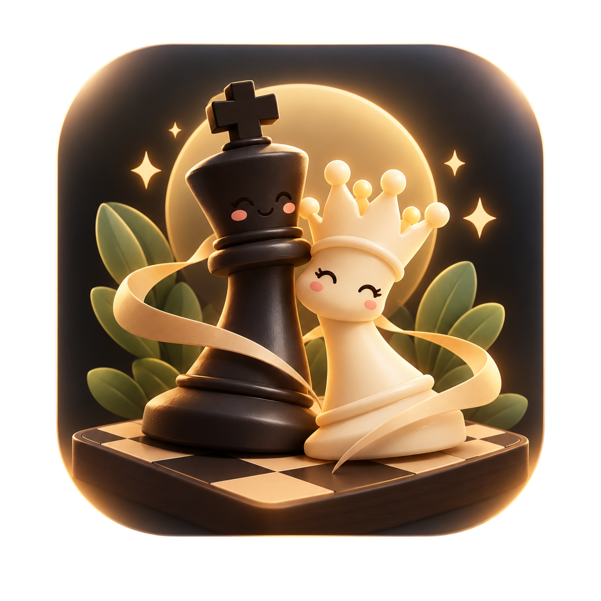

<div align="center">
  

  # ChessMind

  **A private, offline-first Android chess solver, trainer, and match engine.**

  [](https://github.com/YumiNoona/ChessMind/releases/latest)
  [](https://android.com)
  [](https://kotlinlang.org)
  [](https://developer.android.com/jetpack/compose)
  [](https://stockfishchess.org)
  [](#-privacy--offline-first)

  <br />

  <a href="https://github.com/YumiNoona/ChessMind/releases/latest">
    
  </a>
</div>

---

## Overview

**ChessMind** turns your Android device into a personal chess grandmaster and tactical sparring partner. Capture physical boards with your camera, set up opening positions, analyze complex tactics with native Stockfish 19 UCI evaluations, or play timed matches against adaptive AI opponents—all completely offline, private, and free from external servers or accounts.

---

## Key Features

### 📸 Board Scanner & Image Recognition
- **CameraX Live Overlay**: Align and capture physical chessboards with an intuitive framing guide.
- **Gallery Import**: Load saved board photos and screenshots directly from your device storage.
- **Image Review**: Rotate and inspect captured boards before digitizing into legal positions.

### ♟️ Board Editor & Setup
- **Interactive Palette**: Place pieces directly on the board with the tap/drag piece palette.
- **Strict FEN Validation**: Instant legal verification for king counts, pawns on back ranks, and castling rights.
- **Clipboard Integration**: One-click FEN and PGN import/export dialogs for fast studying.
- **Position Details**: Toggle castling rights (`K`, `Q`, `k`, `q`), en-passant target square, and active side to move.

### 🧠 Dual-Engine Hybrid Analysis
- **Packaged Stockfish 19 UCI**: Runs high-speed native UCI evaluations directly on ARM devices.
- **Zero-Crash Fallback**: Built-in cancellable negamax search with alpha-beta pruning ensures uninterrupted analysis on any hardware.
- **Multi-PV Candidate Moves**: Explore primary and alternative continuation lines with interactive on-board move previews.
- **Analysis Presets**: Beginner, Intermediate, Master, and God-mode deep evaluations.

### ⚔️ Match Play & Adaptive AI
- **Play vs AI**: Choose between Gentle, Adaptive, and Tough opponents that make human-like mistakes or calculate with tactical precision.
- **Pass & Play (Friend Mode)**: Play face-to-face on a single device with optional auto-flip board orientation.
- **Full FIDE Rule Support**: Accurate pawn promotions with piece selection (Queen, Knight, Rook, Bishop), castling, en-passant, 50-move rule, threefold repetition, and insufficient material draws.
- **Clocks & Time Controls**: Bullet, blitz, and rapid controls (3m, 5m, 10m) plus unlimited time.

### 📊 Game Review & Tactical Practice
- **Two-Sided Game Review**: Step through every ply of completed games with best-move comparisons, evaluation badges, and quick review summaries.
- **Daily Tactical Training**: Solve curated chess puzzles across diverse motifs (pins, forks, back-rank mates, deflections) with streak tracking.
- **Saved Ideas Library**: Save interesting positions directly from analysis and revisit them anytime.

### 🎨 Personalization & Smooth Board Controls
- **Board Themes**: Classic Wood, Forest Green, Ocean Blue, and Slate Grey.
- **5 High-Res Piece Sets**: Rhosgfx, Fantasy, Spatial, Celtic, and Chessnut with zero outline artifacts.
- **Controls & Accessibility**: Real-time legal move hints, last move highlights, coordinate labels, haptic feedback, and full Dark/Light Material 3 themes.

---

## 🔒 Privacy & Offline-First

- **Zero Cloud Reliance**: No remote servers, cloud engines, or data uploads.
- **No Accounts or Logins**: Start playing and analyzing immediately.
- **No Analytics or Trackers**: Your games, scans, and positions stay 100% on your device.
- **Local Data Export**: Backup and restore match history and saved positions as clean JSON files anytime.

---

## Project Structure

```text
app/src/main/
├── assets/licenses/                 # Third-party license documentation
├── java/app/chessmind/
│   ├── data/                        # Local persistence, profile, and history stores
│   │   └── engine/                  # Stockfish process adapter and lifecycle manager
│   ├── domain/engine/               # Engine contracts, negamax search fallback
│   ├── domain/model/                # Immutable Position, ChessRules, FEN, PGN parser
│   ├── MainActivity.kt              # Jetpack Compose UI, animated navigation, screens
│   └── MainViewModel.kt             # Unidirectional state management and workflows
scripts/
├── fetch-stockfish.ps1              # Reproducible Stockfish binary fetcher
└── render_piece_sets.mjs            # SVG-to-PNG piece resource pipeline
third_party/chess_pieces/            # Upstream piece set artwork
```

---

## Requirements & Building

- **JDK**: Version 17
- **Android SDK**: API 36 (targetSdk 36, minSdk 26 for Android 8.0+)
- **Build Tool**: Gradle 8.11.1+ with Android Gradle Plugin 8.8.2

### Run Unit Tests
```bash
./gradlew test
```

### Build Release APK
```bash
./gradlew assembleRelease
```
The optimized and minified release APK will be generated at `app/build/outputs/apk/release/app-release.apk`.

---

## 📜 Licensing & Attributions

- **Stockfish**: Licensed under [GPLv3](app/src/main/assets/licenses/stockfish-gpl-3.txt).
- **Typography**: Space Grotesk and JetBrains Mono are licensed under the [SIL Open Font License](http://scripts.sil.org/OFL).
- **Chess Piece Artwork**: Sourced from the official Lichess repository (`rhosgfx`: CC0 1.0, `fantasy`/`spatial`/`celtic`: MIT, `chessnut`: Apache 2.0). See [THIRD_PARTY_NOTICES.md](THIRD_PARTY_NOTICES.md) for full attribution.

---

<div align="center">
  <p>Made with 💙 By <a href="https://venusapp.in" target="_blank">Veil</a></p>
</div>
